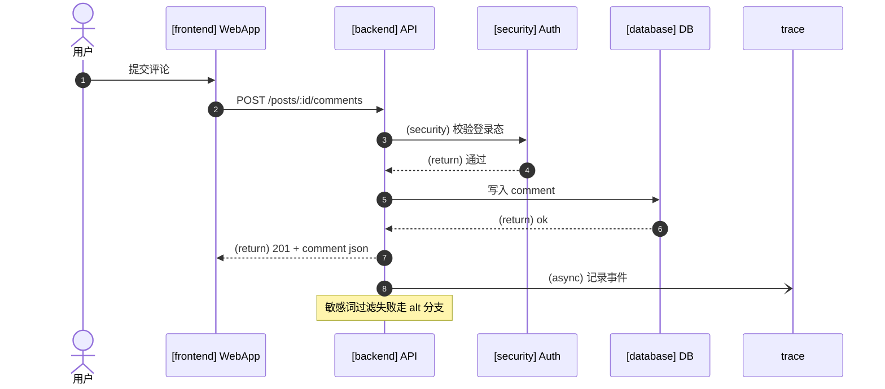
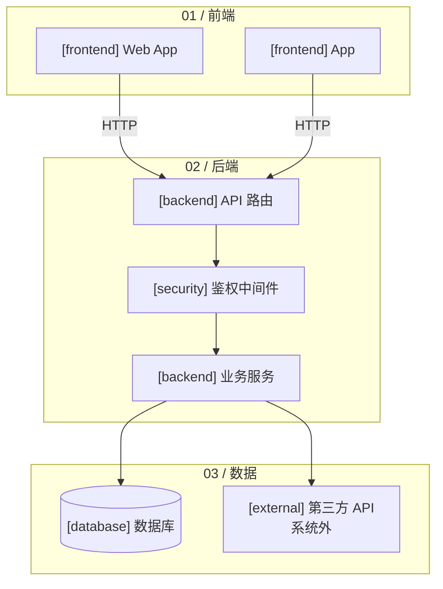
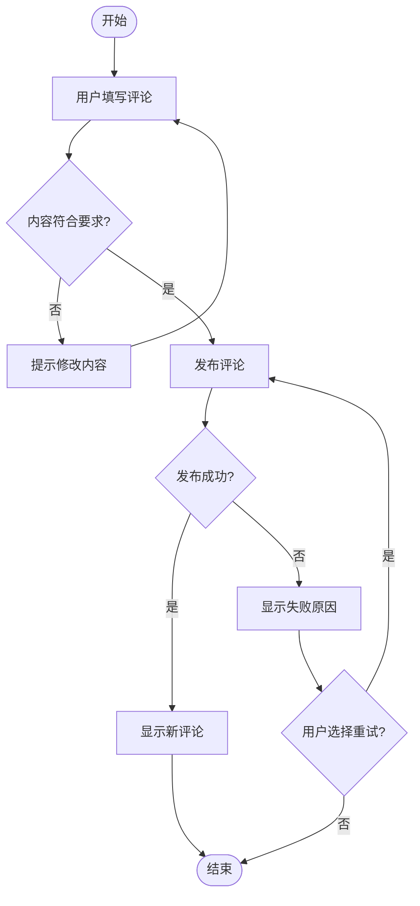
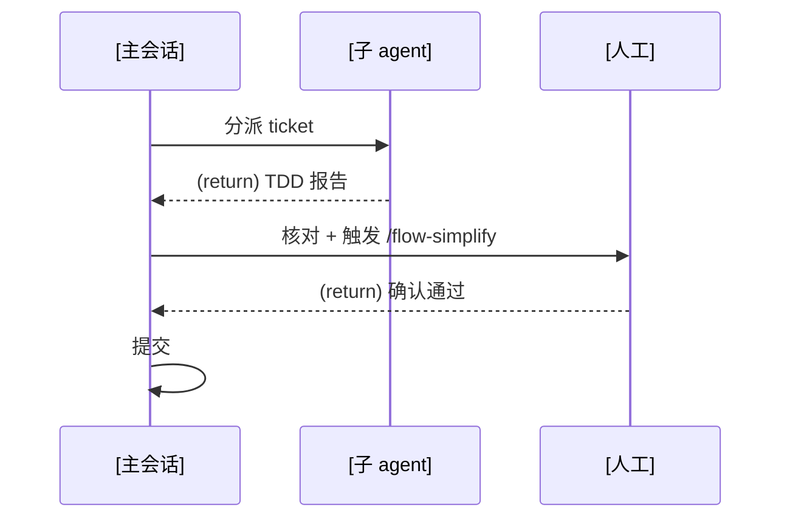

# Diagram Guide — Mermaid

Use Mermaid source for dev-flow-skills diagrams: readable by agents, renderable by the supported documentation viewers, and reviewable as text diffs.

**Variants carry meaning.** Shapes/arrows are semantics, not decoration. Labels contain data; never remove them for layout. New display labels follow artifact language; supplied diagram data remains authoritative.

Use a project architecture flowchart with swimlanes for `.scratch/architecture.md`. Embed smaller business flowcharts and cross-participant sequence diagrams in Specs, keeping maintenance proportional.

## 1. Component types

Architecture nodes and call participants may use the seven archify componentType prefixes. Business workflows use actions/decisions instead and do not require component tags.

| Prefix | Meaning |
|--------|---------|
| `[frontend]` | UI/frontend |
| `[backend]` | Service/API |
| `[database]` | Storage |
| `[cloud]` | Cloud/infrastructure |
| `[security]` | Authentication/security boundary |
| `[messagebus]` | Queue/event bus |
| `[external]` | External actor/third party |

## 2. Cross-participant sequence diagrams

Embed the end-to-end call flow in the Spec approach.

| Syntax | Meaning |
|--------|---------|
| `A->>B: action` | Synchronous call |
| `A-->>B: (return) result` | Dashed return |
| `A-)B: (async) event` | Asynchronous/open-arrow message |
| `Note over A[,B]: text` | Branch, boundary, or placeholder annotation |
| `alt ... else ... end` | Conditional branch |
| `loop ... end` | Loop |
| `actor U as user` | External actor |

Syntax template:



Keep participant order fixed and time top-to-bottom. Label meaningful calls with protocol/action. Explicitly identify return/async/security semantics. Use Notes for important internal/external, existing/new, or placeholder/production boundaries.

## 3. Full project architecture

Use a flowchart for the map in `.scratch/architecture.md`.



Use `subgraph "NN / responsibility"` swimlanes such as 01/02/EX/04. Keep one horizontal main path; branches/dispatch extend vertically. Nodes contain type/name and optionally `|HTTP/SQL|` relationship labels. Aim for 6–12 main components; put external systems in a separate lane or mark them external.

## 4. Feature business workflow

Embed in the Spec approach to explain entry-to-outcome behavior, meaningful decisions, failures, and exits. Module changes remain a prose list, not this graph's backbone.



Use rounded start/end nodes, rectangular actions, diamonds for decisions, and edge labels for conditions/user choices. Use domain glossary terms rather than file/database/API dependencies as the main flow. Show only confirmed branches; do not invent login, validation, or retry merely because a template contains them. Mark unresolved paths. Distinguish user retry from automatic retry, give failure/cancellation clear destinations, and do not turn business loops into unconditional infinite cycles.

## 5. Cross-responsibility workflows

Use sequenceDiagram or flowchart+subgraph for responsibilities such as main session/child/user.



Use one participant per responsibility, with a downward happy path. Put exceptions/rejection/retry in alt/else side paths rather than mixing them into the main flow.

## 6. General conventions

1. Semantics before alignment or appearance.
2. Business edges identify conditions/choices; call edges identify protocol/action/direction (`|HTTP|`, `(return)`, `(async)`), not an uninformative connection label.
3. One clear main path. Business branches use decisions and labeled solid edges; sequence branches use alt/else.
4. Match complexity: architecture flowchart+subgraph, feature flowchart, participant calls sequenceDiagram.
5. Use fenced mermaid so renderers recognize the source.
6. Treat diagrams as source and commit them with the relevant Spec/ticket when Git actions are authorized; review evolution through diffs.

## 7. Disposable step-by-step presentation

On a manual request, turn an **existing** Mermaid diagram into a single-file HTML/SVG presentation with previous/next narration and drawn-stroke animation. Use SVG stroke-dasharray growth, not simulated ink filling. Do not redesign the input diagram; the Spec source remains authoritative.

Load mermaid.js from a CDN (network required), render SVG, then animate paths. Mark the presentation **throwaway**: it is not committed, added to CI, or maintained as a test.

Split by semantics rather than coordinates: a flowchart step is a main-chain segment, branch, or subgraph; a sequence step is a message or a whole alt/loop block. Add one explanatory sentence per step.

The template uses rendered node IDs like `g-flowchart-<nodeId>-<n>` and edge `data-id="L_<from>_<to>_0"`. Initially apply step-hidden; reveal each step and use getTotalLength() to set `--len` for drawing animation. Keep subgraph containers visible. Replace SRC and STEPS in the template:

```html
<!DOCTYPE html>
<html lang="zh">
<head>
<meta charset="utf-8">
<title>手绘分步演示</title>
<style>
  body { background:#F5EBD7; font-family:"Segoe Print","Comic Sans MS","PingFang SC",cursive,sans-serif; margin:0; padding:20px; }
  #controls { margin:12px 0; }
  button { font-size:16px; padding:6px 16px; margin-right:8px; cursor:pointer;
           background:#fff; border:2px solid #5a4a3a; border-radius:8px; font-family:inherit; }
  button:hover { background:#f0e6d2; }
  #caption { margin:12px 0; font-size:19px; min-height:28px; color:#3a2f26; }
  #progress { color:#8a7a6a; font-size:14px; }
  @keyframes draw { to { stroke-dashoffset: 0; } }
  .drawing {
    stroke-dasharray: var(--len, 600);
    stroke-dashoffset: var(--len, 600);
    animation: draw 0.85s ease-in-out forwards;
  }
  .fade-in { animation: fadein 0.4s ease forwards; }
  @keyframes fadein { from { opacity:0; } to { opacity:1; } }
  .step-hidden { visibility: hidden; }
  .step-shown { visibility: visible; }
</style>
</head>
<body>
<div id="controls">
  <button id="prev">← 上一步</button>
  <button id="next">下一步 →</button>
  <button id="restart">重播</button>
  <span id="progress"></span>
</div>
<div id="caption">点「下一步」开始</div>
<div id="diagram"></div>

<script src="https://cdn.jsdelivr.net/npm/mermaid@11/dist/mermaid.min.js"></script>
<script>
const SRC = `<MERMAID_图源>`;
// 每步：nodes=本步出现的节点 id，edges=[[from,to]]，text=旁白（按语义顺序）
const STEPS = [ /* { nodes:["a"], edges:[["a","b"]], text:"..." } */ ];
let cur = -1;
const diagram = document.getElementById('diagram');
const caption = document.getElementById('caption');
const progress = document.getElementById('progress');

function edgeSel(f,t){ return `[data-id^="L_${f}_${t}_"], path[class*="L_${f}_${t}_"]`; }
function nodeEls(id){ return document.querySelectorAll(`[id*="flowchart-${id}-"]`); }
function setLen(el){ try{ if(el.getTotalLength) el.style.setProperty('--len', el.getTotalLength()); }catch(e){ el.style.setProperty('--len',600); } }
function paintables(scope){ return scope.querySelectorAll('path, line, polyline, rect, circle, ellipse, polygon'); }
function showStep(i, animate){
  const s = STEPS[i];
  s.nodes.forEach(id=> nodeEls(id).forEach(g=>{
    g.classList.remove('step-hidden'); g.classList.add('step-shown');
    if(animate){
      paintables(g).forEach(p=>{ setLen(p); p.classList.remove('drawing'); void p.getBoundingClientRect(); p.classList.add('drawing'); });
      g.classList.remove('fade-in'); void g.getBoundingClientRect(); g.classList.add('fade-in');
    }
  }));
  (s.edges||[]).forEach(([f,t])=> document.querySelectorAll(edgeSel(f,t)).forEach(e=>{
    e.classList.remove('step-hidden'); e.classList.add('step-shown');
    if(e.parentElement){ e.parentElement.classList.remove('step-hidden'); e.parentElement.classList.add('step-shown'); }
    if(animate){ setLen(e); e.classList.remove('drawing'); void e.getBoundingClientRect(); e.classList.add('drawing'); }
  }));
}
function hideAll(){
  STEPS.forEach(s=>{
    s.nodes.forEach(id=> nodeEls(id).forEach(g=>{ g.classList.add('step-hidden'); g.classList.remove('step-shown','drawing','fade-in'); }));
    (s.edges||[]).forEach(([f,t])=> document.querySelectorAll(edgeSel(f,t)).forEach(e=>{ e.classList.add('step-hidden'); e.classList.remove('step-shown','drawing'); }));
  });
}
function render(){
  progress.textContent = (cur+1) + ' / ' + STEPS.length;
  caption.textContent = cur>=0 ? STEPS[cur].text : '点「下一步」开始';
}
function next(){ if(cur < STEPS.length-1){ cur++; showStep(cur, true); render(); } }
function prev(){ if(cur>=0){ hideAll(); cur--; for(let k=0;k<=cur;k++) showStep(k,false); render(); } }
function restart(){ hideAll(); cur=-1; render(); }

(async ()=>{
  mermaid.initialize({ startOnLoad:false, theme:'neutral', flowchart:{ htmlLabels:true } });
  const { svg } = await mermaid.render('g', SRC);
  diagram.innerHTML = svg;
  hideAll(); render();
  document.getElementById('next').onclick = next;
  document.getElementById('prev').onclick = prev;
  document.getElementById('restart').onclick = restart;
})();
</script>
</body>
</html>
```

Prefer the ready-to-use CDN; inline Mermaid only for fully offline targets and explain the larger file. Keep each animation at most one second and the overall sequence manageable, generally at most 12 steps. Before delivery, run it in a browser and verify drawing, previous/next navigation, and synchronized narration (e.g. with the available browser/Playwright tooling). The original Spec Mermaid remains the sole source; HTML is a regenerable review aid.
