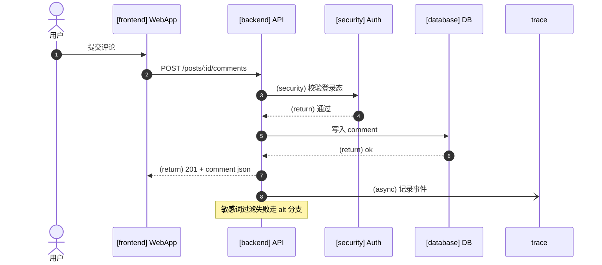
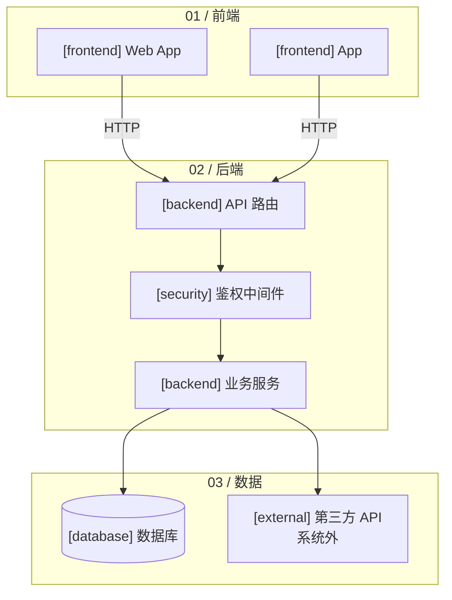
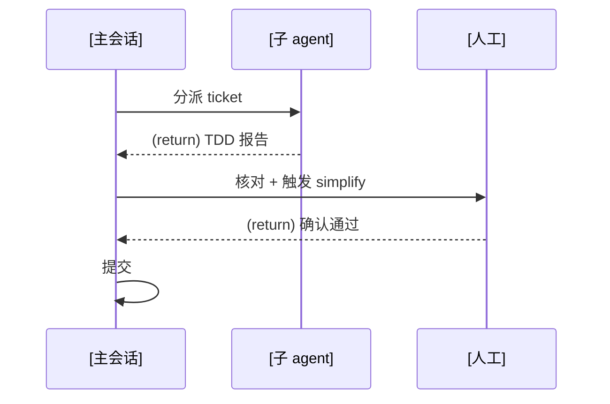

# 图示规范（Diagram Guide）— Mermaid 版

dev-flow-skills 的图示约定。**统一使用 mermaid 语法**：渲染友好（GitHub/飞书/IDE/02 文档生态原生支持）、源码即文本可进 git diff、agent 直接可读写。

**核心原则：变体即语义。** 符号承载含义，不是装饰。标签是语义数据，不能为排版删除。

**分两档复杂度：**
- **架构图**：项目级模块地图（`.scratch/architecture.md`）——`flowchart` + 泳道 subgraph，看得人多、生成一次
- **spec 内嵌图**：功能流程图（`flowchart`）表达业务路径，时序图（`sequenceDiagram`）表达跨参与者调用——更新频繁，控制维护成本

---

## 一、组件类型（7 类枚举，沿用 archify componentType）

架构节点与调用参与者可用 `[type]` 前缀承载类型语义；功能流程图使用业务动作与判断，不要求组件类型标记：

| 标记 | 含义 |
|------|------|
| `[frontend]` | 前端/UI |
| `[backend]` | 后端服务/API |
| `[database]` | 存储 |
| `[cloud]` | 云服务/基础设施 |
| `[security]` | 鉴权/安全边界 |
| `[messagebus]` | 消息队列/事件总线 |
| `[external]` | 系统外角色/第三方 |

---

## 二、时序图（sequenceDiagram）— 跨参与者调用

**用途：** feature 的端到端调用流，嵌入 spec 的"方案概述"。

**语义符号（mermaid 原生，对应语义）：**

| 语法 | 含义 |
|------|------|
| `A->>B: 动作` | 同步调用 |
| `A-->>B: (return) 结果` | 返回（虚线） |
| `A-)B: (async) 事件` | 异步消息（开放箭头） |
| `Note over A[,B]: 文本` | 备注（分支条件/边界/占位标注） |
| `alt ... else ... end` | 条件分支 |
| `loop ... end` | 循环 |
| `actor U as 用户` | 外部参与者 |

**模板：**



**约束：**
- 参与者顺序固定，时间自上而下
- 每个有含义的调用都带标签（协议/动作），不省略
- return/async/security 必须标注——这是语义不是装饰
- 关键边界（系统内外/现有 vs 新增/占位 vs 正式）用 `Note` 标注

---

## 三、架构图（flowchart）— 完整版（项目级）

**用途：** 项目级模块地图，`.scratch/architecture.md`。

**模板：**



**约束：**
- 泳道用 `subgraph "NN / 职责方"`（01/02/EX/04...）
- 一条横向主流程，分支/分派走纵向
- 节点文本带类型标记 + 名称（可选 `|HTTP/SQL|` 关系标签）
- 6-12 个主组件；系统外组件单独泳道或标注"系统外"

---

## 四、功能流程图（feature workflow）— flowchart

**用途：** 嵌入 spec 的“方案概述”，让读者看懂功能从入口到结果如何流转，包括关键判断、失败和退出路径。模块改动范围用文字清单记录。

**模板：**


**约束：**
- 入口/结束使用圆角节点，业务动作用矩形，条件用菱形，分支箭头写明条件或用户选择
- 用领域词典中的业务术语，不把模块名、接口路径、数据库或文件依赖作为流程主干
- 只画已确认的分支；登录、校验、重试等按具体需求决定，不因模板示例而自动加入。未明确的路径标注待确认
- 用户重试与自动重试分别表述，失败与取消有明确去向，不把业务循环画成无条件无限循环

---

## 五、流程/泳道图（跨职责 workflow）— sequenceDiagram 或 flowchart+subgraph

**用途：** 跨职责方的流程（如 主会话/子agent/人工 协作）。

**模板（sequenceDiagram 泳道化）：**



**约束：**
- 每列一个职责方，happy path 单调向下
- 异常/拒绝/重试用 `alt`/`else` 旁路，不混进主流程

---

## 六、通用约定

1. **语义 > 排版**：先保证结构正确、标签完整，再考虑对齐美观
2. **标签必带语义**：功能流程标业务条件与选择；调用关系标协议/动作/方向（`|HTTP|`、`(return)`、`(async)`），不写无信息的 `连接`
3. **单一主干**：先画清晰主线；功能流程用条件节点与带标签的实线分支，时序分支用 `alt`/`else`，不堆砌
4. **复杂度分档**：架构图用 flowchart+subgraph（第三节）；spec 功能流程用 flowchart（第四节），跨参与者调用用 sequenceDiagram（第二节）
5. **代码块标注**：统一用 ```` ```mermaid ```` 围栏（渲染器识别）
6. **进 git**：文本即源码，随 spec/ticket 提交，diff 可见演进

---

## 七、手绘风分步演示（评审讲解用）— 单文件 HTML + SVG 描边动画

**用途：** 评审/讲解时，把一张已有的 mermaid 图（flowchart / sequenceDiagram）变成"点按钮、一步步画出来"的手绘演示，帮助听众跟上。线条以"描边生长"动画逐笔出现（选型 A：SVG `stroke-dasharray` 动画，纯前端实时），不是毛笔填墨质感。

**形态：** 单文件 HTML。内嵌 mermaid.js（**走 CDN，需联网**）把图源渲染成 SVG，再对路径做描边生长动画；配上一步 / 下一步按钮，逐步"画出"当前语义段。**临时演示资产，标注 throwaway，不进 git、不进 CI、不进测试。**

**调用：** 主会话手动触发（"把这张图做成手绘分步演示"）。agent 读**已有** mermaid 图 → 拆语义步骤 → 生成单文件 HTML。**不重新设计图**——输入以 spec 里现成的图为准。

**拆步骤约定（语义分段，非按坐标）：**
- flowchart：每步 = 一个语义段（一条主链 / 一个分支 / 一个子流程 subgraph）
- sequenceDiagram：每步 = 一条消息（或一个 `alt`/`loop` 块整体）
- 每步配一句旁白（"这一步在讲什么"），显示在按钮旁

**HTML 模板（已验证可用，agent 只需替换 `SRC` 和 `STEPS`）：**

关键实现点（已实测）：mermaid 渲染后，**节点 id 形如 `g-flowchart-<nodeId>-<n>`**、**边 `data-id="L_<from>_<to>_0"`**。机制 = 初始把各步元素加 `.step-hidden`，逐步移除并给路径写入 `--len`（`getTotalLength()` 量长）触发 `.drawing` 描边动画。subgraph 容器框保持常显。

```html
<!DOCTYPE html>
<html lang="zh">
<head>
<meta charset="utf-8">
<title>手绘分步演示</title>
<style>
  body { background:#F5EBD7; font-family:"Segoe Print","Comic Sans MS","PingFang SC",cursive,sans-serif; margin:0; padding:20px; }
  #controls { margin:12px 0; }
  button { font-size:16px; padding:6px 16px; margin-right:8px; cursor:pointer;
           background:#fff; border:2px solid #5a4a3a; border-radius:8px; font-family:inherit; }
  button:hover { background:#f0e6d2; }
  #caption { margin:12px 0; font-size:19px; min-height:28px; color:#3a2f26; }
  #progress { color:#8a7a6a; font-size:14px; }
  @keyframes draw { to { stroke-dashoffset: 0; } }
  .drawing {
    stroke-dasharray: var(--len, 600);
    stroke-dashoffset: var(--len, 600);
    animation: draw 0.85s ease-in-out forwards;
  }
  .fade-in { animation: fadein 0.4s ease forwards; }
  @keyframes fadein { from { opacity:0; } to { opacity:1; } }
  .step-hidden { visibility: hidden; }
  .step-shown { visibility: visible; }
</style>
</head>
<body>
<div id="controls">
  <button id="prev">← 上一步</button>
  <button id="next">下一步 →</button>
  <button id="restart">重播</button>
  <span id="progress"></span>
</div>
<div id="caption">点「下一步」开始</div>
<div id="diagram"></div>

<script src="https://cdn.jsdelivr.net/npm/mermaid@11/dist/mermaid.min.js"></script>
<script>
const SRC = `<MERMAID_图源>`;
// 每步：nodes=本步出现的节点 id，edges=[[from,to]]，text=旁白（按语义顺序）
const STEPS = [ /* { nodes:["a"], edges:[["a","b"]], text:"..." } */ ];
let cur = -1;
const diagram = document.getElementById('diagram');
const caption = document.getElementById('caption');
const progress = document.getElementById('progress');

function edgeSel(f,t){ return `[data-id^="L_${f}_${t}_"], path[class*="L_${f}_${t}_"]`; }
function nodeEls(id){ return document.querySelectorAll(`[id*="flowchart-${id}-"]`); }
function setLen(el){ try{ if(el.getTotalLength) el.style.setProperty('--len', el.getTotalLength()); }catch(e){ el.style.setProperty('--len',600); } }
function paintables(scope){ return scope.querySelectorAll('path, line, polyline, rect, circle, ellipse, polygon'); }
function showStep(i, animate){
  const s = STEPS[i];
  s.nodes.forEach(id=> nodeEls(id).forEach(g=>{
    g.classList.remove('step-hidden'); g.classList.add('step-shown');
    if(animate){
      paintables(g).forEach(p=>{ setLen(p); p.classList.remove('drawing'); void p.getBoundingClientRect(); p.classList.add('drawing'); });
      g.classList.remove('fade-in'); void g.getBoundingClientRect(); g.classList.add('fade-in');
    }
  }));
  (s.edges||[]).forEach(([f,t])=> document.querySelectorAll(edgeSel(f,t)).forEach(e=>{
    e.classList.remove('step-hidden'); e.classList.add('step-shown');
    if(e.parentElement){ e.parentElement.classList.remove('step-hidden'); e.parentElement.classList.add('step-shown'); }
    if(animate){ setLen(e); e.classList.remove('drawing'); void e.getBoundingClientRect(); e.classList.add('drawing'); }
  }));
}
function hideAll(){
  STEPS.forEach(s=>{
    s.nodes.forEach(id=> nodeEls(id).forEach(g=>{ g.classList.add('step-hidden'); g.classList.remove('step-shown','drawing','fade-in'); }));
    (s.edges||[]).forEach(([f,t])=> document.querySelectorAll(edgeSel(f,t)).forEach(e=>{ e.classList.add('step-hidden'); e.classList.remove('step-shown','drawing'); }));
  });
}
function render(){
  progress.textContent = (cur+1) + ' / ' + STEPS.length;
  caption.textContent = cur>=0 ? STEPS[cur].text : '点「下一步」开始';
}
function next(){ if(cur < STEPS.length-1){ cur++; showStep(cur, true); render(); } }
function prev(){ if(cur>=0){ hideAll(); cur--; for(let k=0;k<=cur;k++) showStep(k,false); render(); } }
function restart(){ hideAll(); cur=-1; render(); }

(async ()=>{
  mermaid.initialize({ startOnLoad:false, theme:'neutral', flowchart:{ htmlLabels:true } });
  const { svg } = await mermaid.render('g', SRC);
  diagram.innerHTML = svg;
  hideAll(); render();
  document.getElementById('next').onclick = next;
  document.getElementById('prev').onclick = prev;
  document.getElementById('restart').onclick = restart;
})();
</script>
</body>
</html>
```

**约束：**
- **开箱即用优先 CDN**；目标环境完全离线时才把 mermaid 内联进 HTML（文件变大，需说明）
- 每步动画 **≤1s**，整体步骤数控制在听众可跟随范围（一般 ≤12 步）
- 交付前 agent 自己在浏览器里跑一遍，确认逐步绘制、prev/next 回退、旁白同步都正常（可用 `pi-agent-browser-native` 或 Playwright MCP 验证）
- 结果只在评审讲解时用；spec 里仍保留原 mermaid 图源作为单一事实（HTML 是派生物，可重新生成）
