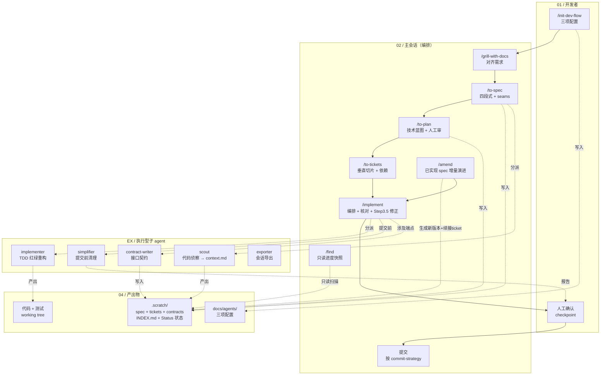

# Dev Flow Skills 项目架构

## 泳道说明

| 泳道 | 职责 |
|------|------|
| 01 / 开发者 | 发起命令、人工确认（checkpoint） |
| 02 / 主会话 | 编排：grill → spec → plan（审）→ tickets → implement（含 Step 3.5 ticket 修正）、find、amend |
| EX / 执行型子 agent | 纯执行：scout（侦察）、implementer（TDD）、simplifier（清理）、contract-writer（契约）、exporter（导出），不提交 |
| 04 / 产出物 | 配置、.scratch（spec/tickets/contracts/INDEX）、代码与测试 |

## 关键流转

- **主流程（实线）**：init → grill → spec → plan（人工审）→ tickets → implement → 人工确认 → 提交
- **增量演进**：已实现 spec 有变动 → amend → 生成 spec-v(N+1) + 更新 INDEX + 续接 ticket → implement
- **分派（虚线）**：spec → scout；implement → implementer / simplifier / contract-writer
- **版本与状态管理**：`.scratch/<feature>/INDEX.md` 记录当前 spec 版本；ticket 用 `Status: ready → claimed → resolved` 记录进度，agent 实现一律先读 INDEX 与 ticket 状态
- **人工卡点**：simplifier 报告 → 人工确认 → 提交

## 设计原则

- **编排与执行分离**：主会话决策，子 agent 执行
- **决策前置**：spec/ticket/plan 拍死决策（spec=产品、plan=技术、ticket=执行细节），子 agent 遇未覆盖决策即停止报告
- **产出物即输入**：.scratch 的 spec/plan/tickets/INDEX 驱动 implement 与 amend，配置驱动全流程
- **方向修正闭环**：implementer 报方向错误 → 主会话 Step 3.5 对齐修正 + 按需回写 spec → 重新分派（≥2 次则停，人工介入）
