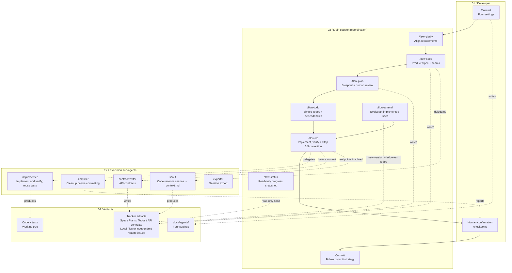

# Dev Flow Skills Architecture

**English** | [简体中文](./architecture.zh-CN.md)

## Swimlanes

| Lane | Responsibility |
|------|----------------|
| 01 / Developer | Invoke commands and provide human checkpoint confirmation |
| 02 / Main session | Coordinate flow-clarify → flow-spec → reviewed flow-plan → flow-todo → flow-do, including Step 3.5 corrections, flow-status, and flow-amend |
| EX / Execution sub-agents | Execute bounded work: scout, implementer, simplifier, contract-writer, and exporter; never commit |
| 04 / Artifacts | Settings, tracker-owned Spec/Plans/Todos/API contracts, local version index or remote provenance, code, and tests |

## Key transitions

- **Main path (solid arrows):** flow-init → flow-clarify → flow-spec → reviewed flow-plan → flow-todo → flow-do → human confirmation → commit.
- **Scope decomposition:** Spec → one or more independent Plans → each Plan's simple engineering Todos. AI chooses the count unless the user specifies count/grouping. Explain actual coverage/independence conflicts first; package numbers do not replace peer Plans.
- **Incremental evolution:** changed Spec → flow-amend → new version and complete applicable Plan registry, updating only affected Plans/Todos while preserving unchanged approvals/acceptance → flow-do.
- **Delegation (dotted arrows):** flow-spec → scout; flow-do → implementer / simplifier / contract-writer.
- **Versions and state:** locally, INDEX identifies the current Spec; remotely, verify tracker version references against each Plan's `Spec:`. Todos separate `Spec:` and `Plan:`. Default states are `ready → claimed → resolved`, with `parked` for deferred work; legacy `code-complete` follows the tracker declaration only. Once implementation, required engineering checks, review, and required artifacts pass, resolve automatically and synchronize/verify remote closure. Squash does not delay downstream engineering work. Human functional acceptance belongs to Plan, otherwise Spec; Git needs separate authorization. Neither delays qualified Todo closure. See `_agents/workflow-contract.md`.
- **Human checkpoint:** simplifier report → human confirmation → commit.

## Design principles

- **Separate coordination from execution:** the main session decides; sub-agents execute.
- **Settle decisions upstream:** Spec owns product decisions, Plan technical choices, and Todo execution details. Workers stop and report uncovered decisions.
- **Artifacts are inputs:** local files or remote Spec/Plan/Todo issues drive implementation. A remote Plan's current approach lives in its own issue body with backlinks; configuration determines the authoritative store.
- **Close the correction loop:** implementer reports a direction error → main session aligns and corrects under Step 3.5, updating the Spec where needed → redispatch. Two consecutive errors stop automatic retries for human alignment.
