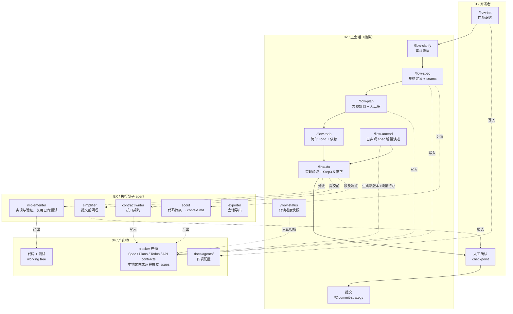

# Dev Flow Skills 项目架构

[English](./architecture.md) | **简体中文**

## 泳道说明

| 泳道 | 职责 |
|------|------|
| 01 / 开发者 | 发起命令、人工确认（checkpoint） |
| 02 / 主会话 | 编排：flow-clarify → flow-spec → flow-plan（审）→ flow-todo → flow-do（含 Step 3.5 待办修正）、flow-status、flow-amend |
| EX / 执行型子 agent | 纯执行：scout（侦察）、implementer（实现与验证）、simplifier（清理）、contract-writer（契约）、exporter（导出），不提交 |
| 04 / 产出物 | 配置、tracker 中的 Spec/Plan/Todos/API contracts、本地版本索引或远程版本引用、代码与测试 |

## 关键流转

- **主流程（实线）**：flow-init → flow-clarify → flow-spec → flow-plan（人工审）→ flow-todo → flow-do → 人工确认 → 提交
- **范围拆解**：Spec → 一个或多个独立 Plan → 各 Plan 的简单工程 Todo；AI 判断 Plan 数量，用户指定数量／分组优先，实际独立性／覆盖冲突先报告，不以内部包编号代替 Plan
- **增量演进**：Spec 有变动 → flow-amend → 更新版本及所有适用 Plan 引用，仅修改受影响的方案／Todo，保留未变范围的批准与验收 → flow-do
- **分派（虚线）**：flow-spec → scout；flow-do → implementer / simplifier / contract-writer
- **版本与状态管理**：本地由 INDEX 记录当前 Spec，远程按 tracker 的版本引用及 Plan 正文 `Spec:` 核对；Todo 用 `Spec:` / `Plan:` 分别关联。默认 `ready → claimed → resolved`，搁置用 `parked`，旧 `code-complete` 只按 tracker 声明兼容。本票实现、必要工程检查、审查和必需产物通过后自动 resolved，远程同步关闭并核对状态；squash 不阻塞下游。人工功能验收集中到 Plan（无 Plan 时 Spec），提交另需用户授权，均不阻止合格待办关闭。共享定义见 `_agents/workflow-contract.md`
- **人工卡点**：simplifier 报告 → 人工确认 → 提交

## 设计原则

- **编排与执行分离**：主会话决策，子 agent 执行
- **决策前置**：Spec/Todo/Plan 拍死决策（Spec=产品、Plan=技术、Todo=执行细节），子 agent 遇未覆盖决策即停止报告
- **产出物即输入**：本地文件或远程 Spec/Plan/Todo issues 驱动实现；远程 Plan 使用独立 issue 正文并双向关联，配置决定主存
- **方向修正闭环**：implementer 报方向错误 → 主会话 Step 3.5 对齐修正 + 按需回写 spec → 重新分派（≥2 次则停，人工介入）
