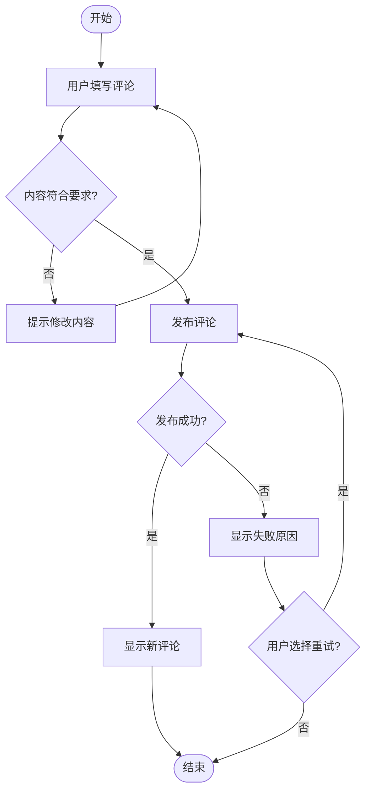
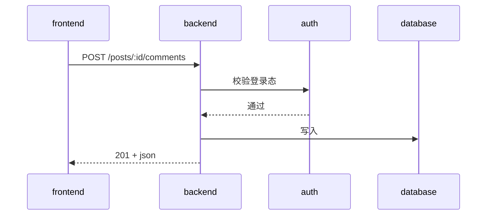

# Flow Spec

Follow the target project's interaction and artifact languages from [language policy](../_agents/language-policy.md); pass both to delegates.

## When to use

- Requirements are aligned through `/flow-clarify`.
- A reviewable, traceable product document is needed.
- Collaborators need shared context.

## Core disciplines

1. **Keep four sections:** problem, non-goals, approach, and module impact.
2. **Analyze test seams**, preferring existing boundaries.
3. **Make non-goals explicit** to prevent scope creep.
4. **Identify affected and unaffected modules.**
5. **Own product intent, not implementation.** Answer what to do, exclude, and assign. Libraries and implementation choices belong to `/flow-plan`.
6. **Examine significant decisions before recording them.** Briefly steelman disputed product choices: restate intent, examine both directions, and identify decisive variables before filling the key-decision table. Apply the global AGENTS.md significance criteria: cross-module impact, alternatives, non-goals, architectural conflict, user-visible behavior, or irreversibility.

## Workflow

### Step 0: Choose the optional HTML review

Before gathering code context or drafting, ask in the interaction language whether this invocation should also produce an HTML Spec review: “本次是否额外生成 HTML 规格阅读版？需要 / 不需要”. Reuse an explicit choice in the current request or this invocation's conversation; do not ask twice. Otherwise wait for the answer, without saving a guessed choice or generating HTML.

The choice applies only to this invocation, not a project/global default. Declining keeps the normal Spec workflow without reading the HTML generation guide or template. Accepting adds a derived reading view; the declared Markdown file or remote Spec issue remains authoritative. No separate requirements-clarification page is produced.

### Step 1: Gather code context

Read `docs/agents/execution-mode.md`; missing means subagent by default. Respect a task override.

In subagent mode, send a read-only scout to the relevant code and save a concise `.scratch/<feature-slug>/context.md` brief with `Files Retrieved / Key Code / Architecture / Existing Seams / Start Here`.

In inline mode, the main session follows `_agents/scout.prompt.md` directly. In either mode, use `CONTEXT.md` terminology and respect existing `docs/adr/`; if absent, continue from code and discussion.

The scout prompt is the sole discovery source. Its brief feeds seam analysis, `/flow-todo`, and `/flow-do`.

### Step 2: Analyze seams

First classify the change under the [shared validation rules](../_agents/workflow-contract.md#验证方式与测试组织). Seam analysis below concerns behavior tests. For documentation, configuration, styles, or refactors, explain applicable checks without inventing runtime boundaries.

Reuse the brief's Existing Seams first. Prefer higher-level existing boundaries:

```
高层接缝（优先）     例：HTTP API、CLI 命令
    ↓ 测试外部行为，不触及内部实现
中层接缝            例：Service 层接口、Repository 接口
    ↓ 测试模块间交互
低层接缝（避免）     例：私有函数、内部工具类
    ↓ 测试实现细节，重构时易破坏
```

Cover the feature's main external behavior. Add another boundary only for a distinct risk, not to duplicate tests at every internal layer. Confirm the proposed boundaries with the user, for example:

```
我建议在以下 seams 测试：
- HTTP API 层：POST /exports（现有 seam，直接复用）
- 不新增 Service 层测试（内部实现可能变化）

是否符合你的预期？
```

### Step 3: Draft the Spec

Use the four-section structure below. Follow `_agents/diagram-guide.md`: put a business `flowchart` in the approach, showing entry, user actions, branches, and outcomes; use `sequenceDiagram` for cross-participant calls. Keep module impact as prose. Wrap diagrams in fenced `mermaid` blocks.

The template illustrates structure; localize human-readable prose under the language policy while preserving protocol fields.

````markdown
## 问题陈述

[一段话描述要解决的问题，包含用户痛点和业务价值]

## 非目标

- [明确不做什么]
- [明确不做什么]

## 方案概述

[高层方案描述，不涉及具体实现细节]

### 功能流程图

[使用业务动作、条件和结果画出已确认的功能路径，包含主流程和关键异常/退出分支。
不把服务、数据库或文件的依赖关系当作功能流程。示例：]



### 测试边界（Seams）

- **主要 seam**: [层级和位置]
- **测试策略**: [按改动类型说明验证方式、需要补充的行为覆盖与可复用的现有测试；不按验收项预设新测试文件]

### 关键决策

| 决策点 | 选项 | 选择 | 理由 |
|-------|------|------|------|
| [决策] | A/B/C | [选择] | [理由] |

### 端到端调用时序图

[用 mermaid sequenceDiagram 画出本 feature 的端到端调用流。
用 ->> 同步、-->> 返回、-) 异步。示例：]



## 模块影响

### 受影响模块
- [模块名]: [新增/修改及具体影响描述]

### 不受影响模块（明确排除）
- [模块名]: [为什么不受影响]
````

### Step 4: Save

Read `docs/agents/issue-tracker.md`; if missing, request `/flow-init`. Follow its paths/formats: locally `.scratch/<feature-slug>/spec.md` with a kebab-case feature slug derived from the requirement; remotely use the declared GitHub/GitLab tool.

Under the [ownership/navigation rules](../_agents/workflow-contract.md#归属层级与列表展示), write `Parent:` at the top: the explicitly identified Epic, or `none`. Keep the four-section body.

- **Local:** Create/update the feature INDEX and `.scratch/README.md` entry. Link the current Spec and actual artifacts only; do not create a placeholder Plan.
- **GitHub:** Use `[Spec]` and the project's type label. If an Epic is specified, establish and verify the native parent relationship. Use the configured Project when present; report unsynchronized items.

When `/flow-plan` later creates the plan, backlink `Plan:` from the current Spec. Locally update only the current Spec/index, preserving frozen versions. Remotely maintain separate bodies rather than placing the current plan in Spec comments.

The Spec defines product acceptance criteria. If tickets proceed without a Plan, add a functional-acceptance subsection within the approach and `Acceptance: pending`; this Spec owns acceptance. With a Plan, link its acceptance entry instead. Maintain one acceptance state, without adding a fifth top-level Spec section.

### Step 4.5: Generate HTML only when requested

Only for an affirmative Step 0 choice, follow [HTML review guidance](references/html-review.md) and use its reading-layout template. Derive the page from the saved authoritative Spec, preserve the source language, content, relationships, and version, and validate the page before presenting it. HTML generation grants no Git submission or publishing permission.

When declined, skip generation and HTML navigation entries. Preserve any existing files; if the source changed, identify an old view as stale rather than presenting it as current. A missing public hosting destination does not block the normal Spec workflow or justify a fake reading link.

### Step 5: Confirm

Present the Spec summary and source reference, plus the validated HTML path/real published URL when requested. Report any incomplete generation or unverified preview accurately. Opening a page is not approval; proceed after user confirmation.

## Outputs and next stage

Produce a structured Spec with business flow, test seams, sequence flow, and explicit module boundaries/impact, plus an HTML reading view only when requested. After confirmation, use `/flow-plan` for the technical choices, implementation path, risks, and approval, then `/flow-todo` for execution details.
