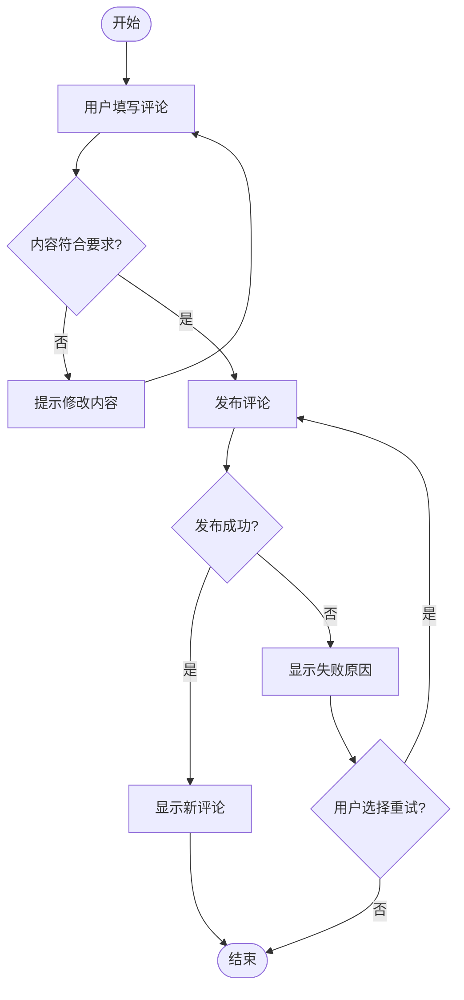
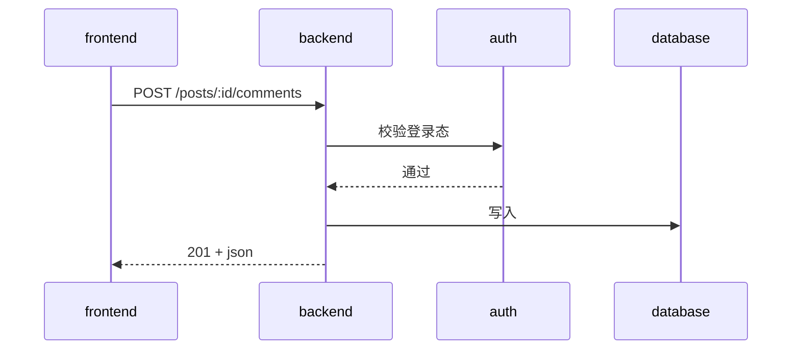

# To Spec

## 触发信号

- 需求已通过 `/grill-with-docs` 对齐
- 需要一份可评审、可追踪的方案文档
- 多人协作，需要共享上下文

## 核心 Discipline

1. **四段式结构** — 问题、非目标、方案、影响，缺一不可
2. **Seams 分析** — 确定测试边界，优先使用现有接缝，减少新增
3. **非目标必须显式** — 明确不做什么，防止范围蔓延
4. **模块影响分析** — 识别所有受影响和不受影响的模块
5. **产品意图与边界，不管技术实现** — spec 只回答"做什么/不做什么/谁负责"。技术选型（用什么库、怎么实现）是 `/to-plan` 的决策范围，不写进 spec
6. **关键决策先论证** — 对有分歧的产品决策，先做一次轻量钢人论证（重述 → 双向 → 找关键变量），再写入"关键决策"表，避免把未对齐的假设固化进 spec。"关键"按全局 AGENTS.md 的判定标准（跨模块影响 / 多方案权衡 / 影响非目标 / 与架构冲突 / 改用户可见行为 / 不可逆）

## 操作步骤

### Step 1: 侦察代码库（默认分派 scout 子 agent）

**先读执行模式：** 读取 `docs/agents/execution-mode.md`（缺失则视为"派子 agent"）。用户可在单次执行时覆盖默认。

**默认 / `subagent` 模式 → 分派 `scout` 子 agent** 侦察本次变更涉及的代码区域，产出压缩上下文到 `.scratch/<feature-slug>/context.md`。scout 只读不改，返回"Files Retrieved / Key Code / Architecture / Existing Seams / Start Here"的结构化简报。

**`inline` 模式 / 用户单次覆盖 → 主会话直接探索**：参照 `_agents/scout.prompt.md` 的方法侦察并记录。

同时（无论哪种模式）：
- 使用项目领域词典（`CONTEXT.md`，若存在）中的术语
- 尊重现有 ADR（`docs/adr/`，若存在）
- 上述文件不存在则跳过，基于代码和对话理解继续

> 侦察逻辑的单一事实源是 `_agents/scout.prompt.md`；产出的 `context.md` 同时是 Step 2 Seams 分析和后续 `/to-tickets`、`/implement` 的输入（契合"产出物即下一阶段输入"）。

### Step 2: Seams 分析

先按[共享验证规则](../_agents/workflow-contract.md#验证方式与测试组织)判断改动类型。以下 seams 分析针对行为测试；纯文档、配置、样式或重构在测试策略中说明适用检查，不强制新增运行时测试边界。

确定测试边界（seams）。优先使用现有接缝，避免新增。**优先复用 scout 简报中 "Existing Seams" 列出的现有接缝。**

**Seams 层级（从高到低）：**

```
高层接缝（优先）     例：HTTP API、CLI 命令
    ↓ 测试外部行为，不触及内部实现
中层接缝            例：Service 层接口、Repository 接口
    ↓ 测试模块间交互
低层接缝（避免）     例：私有函数、内部工具类
    ↓ 测试实现细节，重构时易破坏
```

**原则：**
- 现有 seams 优先于新建 seams
- 尽可能使用最高层 seam
- 覆盖当前功能的主要外部行为；只为独立风险补充其他边界，不默认在每个内部层级重复测试

**输出：** 向用户确认测试边界：
```
我建议在以下 seams 测试：
- HTTP API 层：POST /exports（现有 seam，直接复用）
- 不新增 Service 层测试（内部实现可能变化）

是否符合你的预期？
```

### Step 3: 合成 spec 内容

基于对齐结果和 seams 分析，合成四段式 spec。**图示部分用 Mermaid 表达**（参照 `_agents/diagram-guide.md`）：在方案概述中用 `flowchart` 画功能流程，说明用户从哪里进入、做什么、如何分支、得到什么结果；跨参与者调用继续用 `sequenceDiagram`。模块影响保留文字清单。用 ```` ```mermaid ```` 代码块包裹。

````markdown
## 问题陈述

[一段话描述要解决的问题，包含用户痛点和业务价值]

## 非目标

- [明确不做什么]
- [明确不做什么]

## 方案概述

[高层方案描述，不涉及具体实现细节]

### 功能流程图

[使用业务动作、条件和结果画出已确认的功能路径，包含主流程和关键异常/退出分支。
不把服务、数据库或文件的依赖关系当作功能流程。示例：]



### 测试边界（Seams）

- **主要 seam**: [层级和位置]
- **测试策略**: [按改动类型说明验证方式、需要补充的行为覆盖与可复用的现有测试；不按验收项预设新测试文件]

### 关键决策

| 决策点 | 选项 | 选择 | 理由 |
|-------|------|------|------|
| [决策] | A/B/C | [选择] | [理由] |

### 端到端调用时序图

[用 mermaid sequenceDiagram 画出本 feature 的端到端调用流。
用 ->> 同步、-->> 返回、-) 异步。示例：]



## 模块影响

### 受影响模块
- [模块名]: [新增/修改及具体影响描述]

### 不受影响模块（明确排除）
- [模块名]: [为什么不受影响]
````

### Step 4: 保存 spec

读取 `docs/agents/issue-tracker.md` 判断 tracker 模式；若该文件缺失，提示先运行 `/init-dev-flow`。spec 的存放路径与格式遵循该文件的约定（本地模式为 `.scratch/<feature-slug>/spec.md`，feature-slug 从需求提取 kebab-case；GitHub/GitLab 模式用对应 CLI 创建 issue）。

远程模式在后续 `/to-plan` 创建独立 Plan issue 后，在 Spec issue 正文记录 `Plan:` 引用；spec 和 plan 各自维护正文，不把现行技术方案放在 spec 评论中。

### Step 5: 用户确认

向用户展示 spec 摘要，确认无误后进入下一阶段。

## 产出物

- 结构化 spec 文档（含功能流程图、seams 分析与端到端调用时序图）
- 明确的模块边界和影响范围

## 下一步

Spec 确认后，进入 `/to-plan` 阶段，产出本地 plan.md 或独立 Plan issue，把技术选型、实现路径、风险点在实现前拍死并审批，再由 `/to-tickets` 拆执行细节。
